<div align="center">

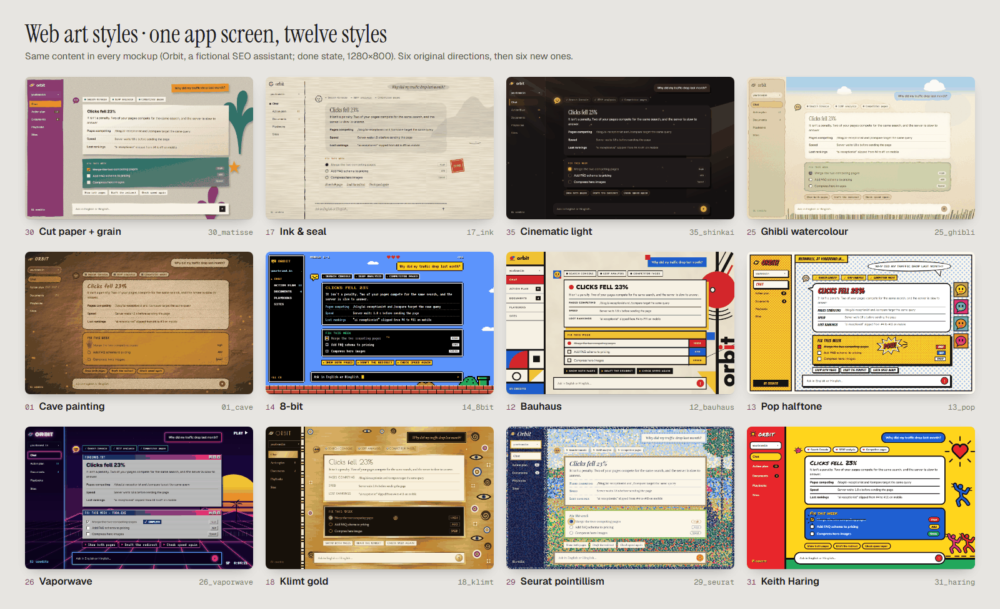

# web-art-styles

Design websites and app UIs in art styles people recognise at a glance, and can still use.

53 style cards · 12 rendered screen mockups · palettes, techniques and a review protocol

```sh
npx skills add him4318/web-art-styles
```

**Every screen above is a real product in disguise.** It's the chat screen of [qelvra.in](https://qelvra.in), the AI agent that reads your site and tells you exactly why your traffic dropped. Curious what it would say about yours? **[Ask it →](https://qelvra.in)**

</div>

## What it does

An agent skill for Claude Code, Cursor, Codex and other coding agents that support skills. Ask for a site, a page, a theme or an optional "look" *in the style of* an artist, movement, studio or retro medium, and the agent will:

1. **Offer three directions** as the same real screen, each with a different composition idea, not three recolours.
2. **Extract the style's language** (materials, marks, colour relationships, light, form, space) without copying famous works or characters.
3. **Build it as a real UI:** tokens, surfaces, edges, components, motion and loading or done moments, with CSS, SVG and canvas recipes that stay fast.
4. **Review it honestly** against reference artworks and against product checks: WCAG contrast, reduced motion, phone width, performance.

## The styles

Every card covers recognisable traits, palette, typography, surfaces and edges, layout, components, motion, techniques, performance and accessibility, pitfalls, and how to tell it from its nearest neighbours. Full list in [`references/styles/INDEX.md`](references/styles/INDEX.md).

- **Built treatments (36):**
  - **Material layer:** Van Gogh, Impressionism, Seurat, Ghibli watercolour, Chinese ink, pop halftone, 8-bit, vaporwave, Shinkai light, Rembrandt, Cubism, Matisse cut-outs, 2026 flat illustration, Constructivism, Bauhaus, Roman mosaic, ray-traced CGI.
  - **Period specimens:** cave painting, Egyptian tomb painting, Greek black-figure, Gothic illumination, Renaissance sfumato, Art Nouveau, Klimt, Munch, Dunhuang, Kusama, Dalí, Hopper, Kirby comics, Monet, Haring, 1930s rubber-hose, shadow puppets, Picasso's Blue Period, flat adult-animation cartoon.
- **Research recipes (17):** Giotto, Piero della Francesca, Raphael, Michelangelo, Guardi, Lorenzetti, Cortona, Renoir, Pissarro, Sisley, Gauguin, Chagall, Ma Yuan, Persian miniature, South Park-style cut paper, Pixar, Northern-dynasty Dunhuang. These are sourced hypotheses and are clearly marked as unproven.

## Mockups

`assets/mockups/` holds self-contained HTML screens (open them directly or use them as starting points), each with a rendered PNG. They all restyle one real screen from [qelvra.in](https://qelvra.in), an AI SEO and AEO agent, renamed "Orbit" here so the content stays neutral. Same findings, same buttons, twelve completely different products.

| | | |
|---|---|---|
| 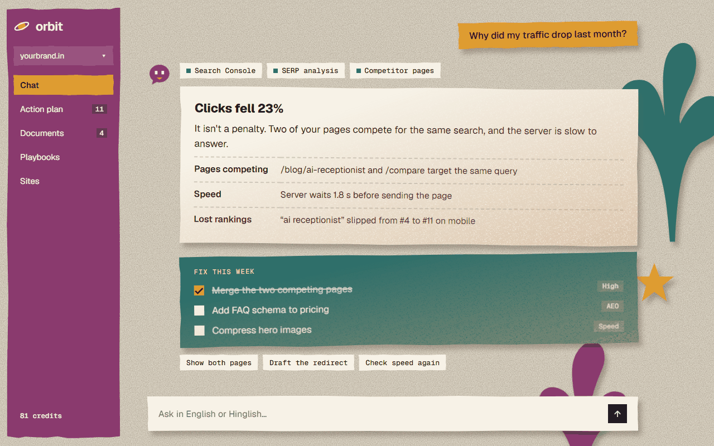 Cut paper + grain | 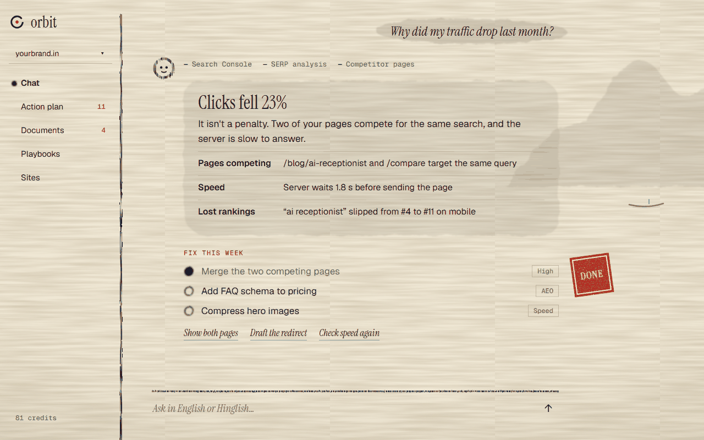 Ink & seal | 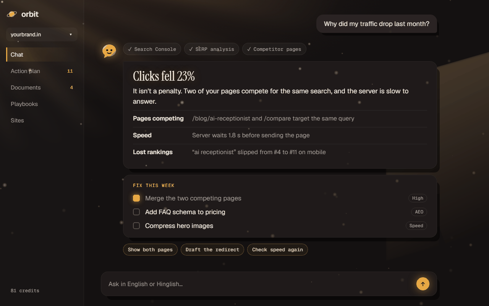 Cinematic light |
| 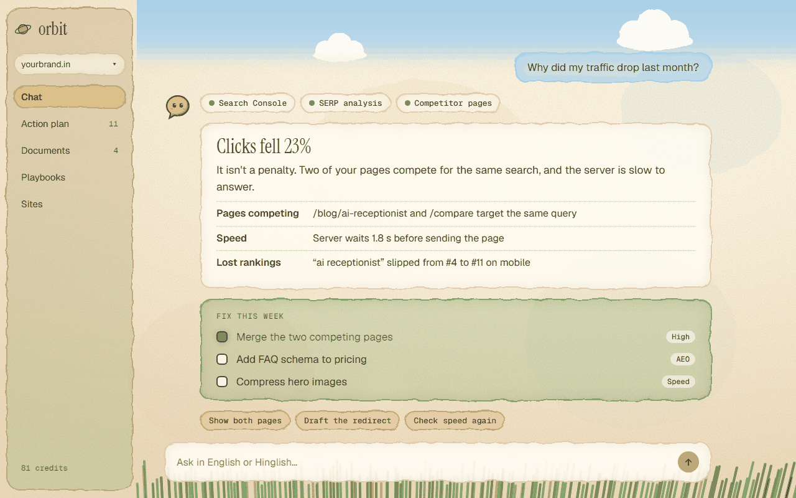 Ghibli watercolour | 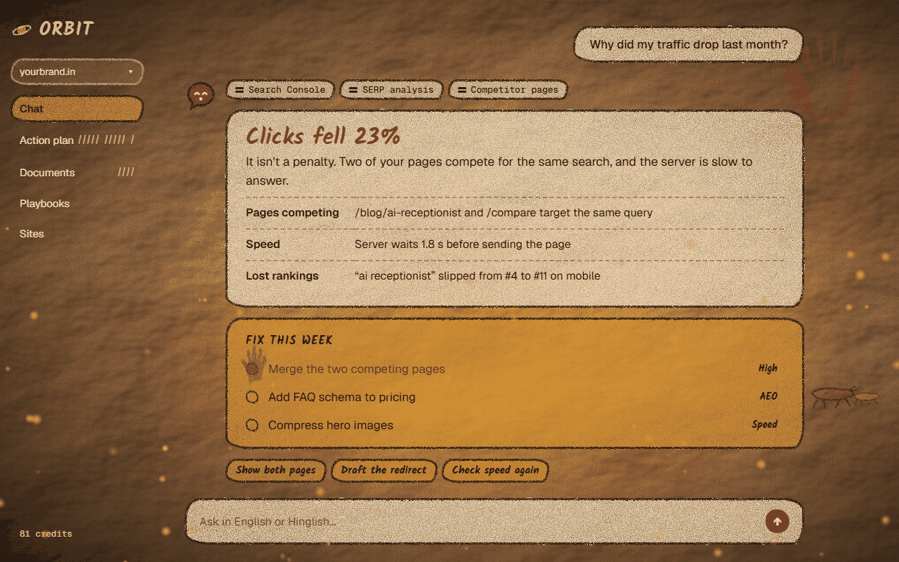 Cave painting | 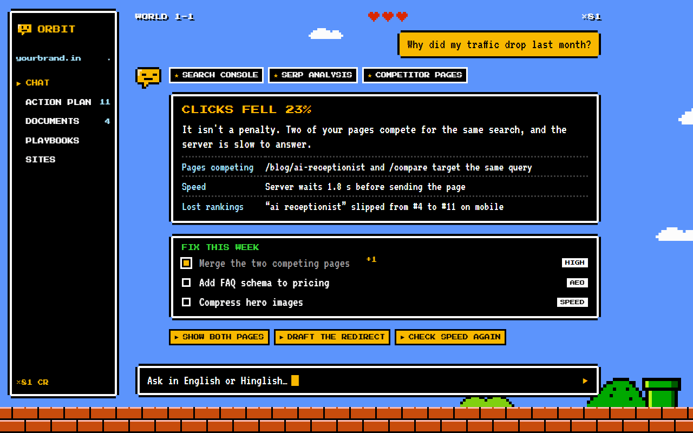 8-bit |
| 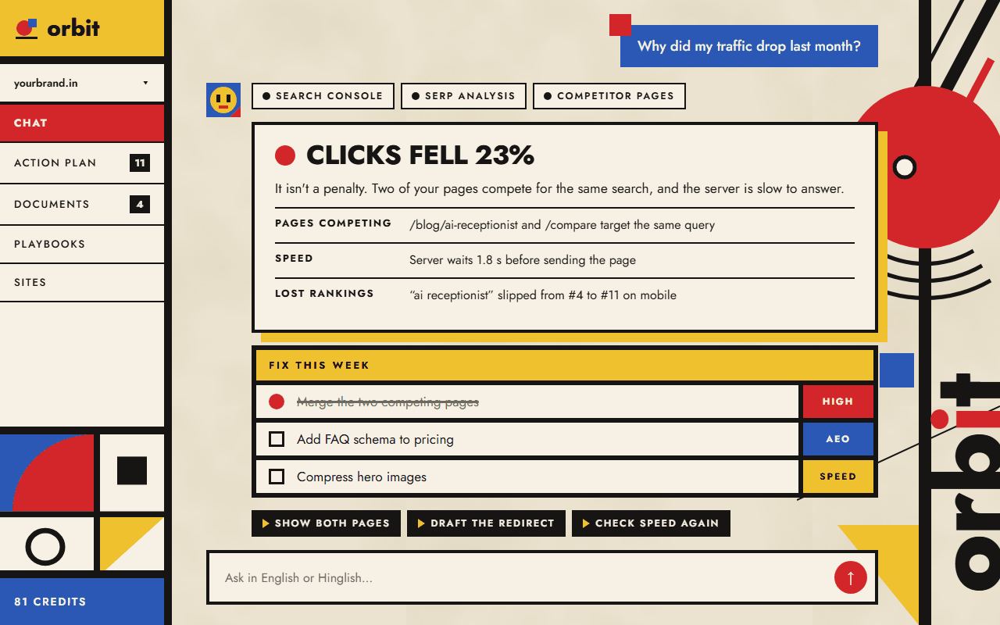 Bauhaus | 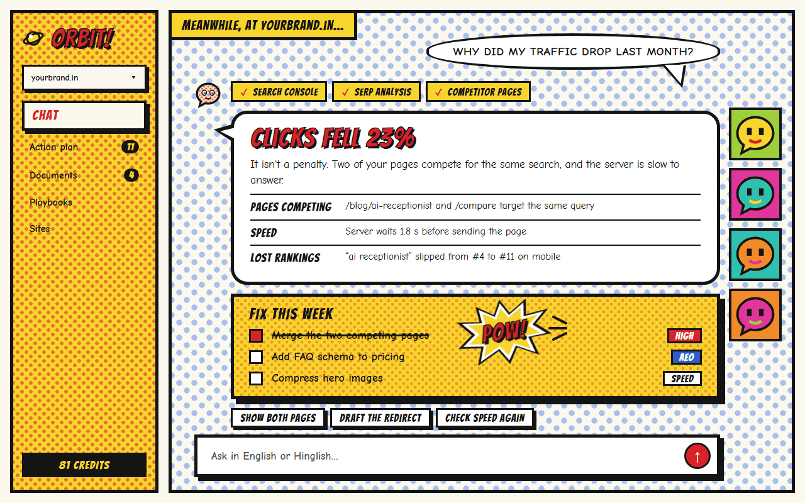 Pop halftone | 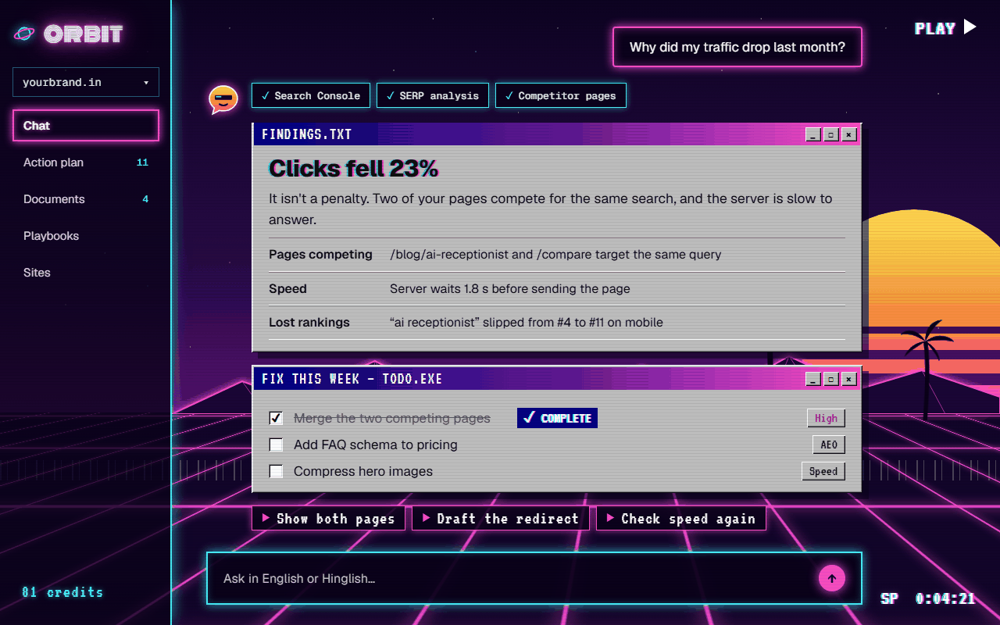 Vaporwave |
| 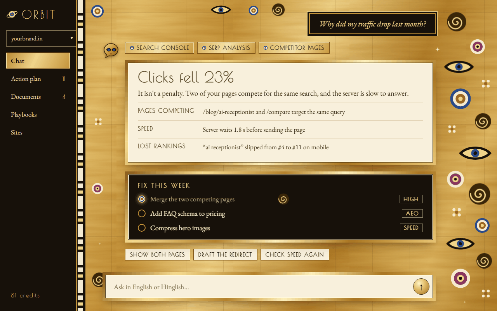 Klimt gold | 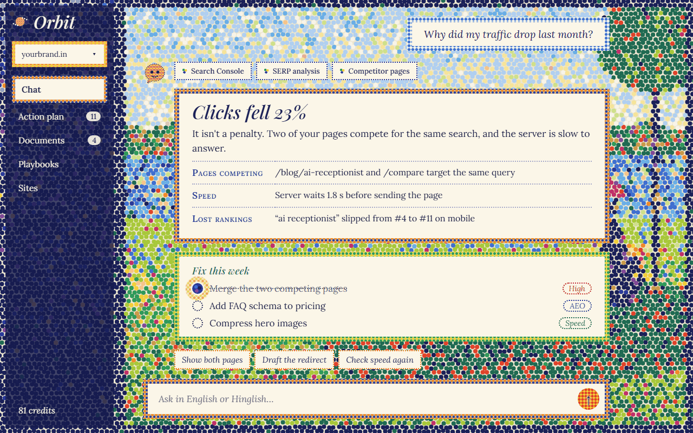 Seurat | 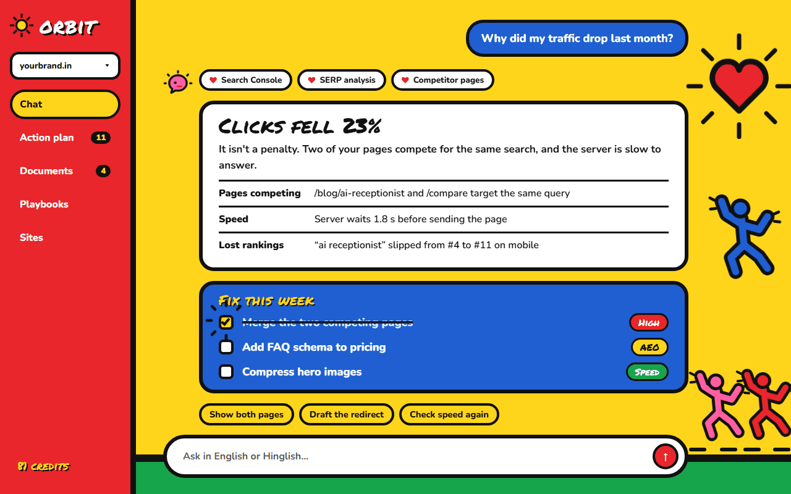 Keith Haring |

## Try it

> Make our pricing page in the style of Matisse's cut-outs: light and dark.

> Give the dashboard an optional 8-bit look as an easter egg, off by default.

> Three directions for a tea brand's landing page inspired by Chinese ink painting.

> Turn Hopper's hard sunlight into a hero section and a loading state.

## What's inside

```
SKILL.md                         how the agent works with styles
references/styles/INDEX.md       all 53 styles: layer, status, web fit, mockup
references/styles/<id>.md        one card per style
references/styles/_TEMPLATE.md   format for adding styles
references/translating-a-style.md
references/web-techniques.md     medium → CSS/SVG/canvas recipes, look architecture
references/palettes.md           eight UI palettes and colour rules
references/review.md             reference-anchored scoring and UI checks
assets/mockups/                  HTML mockups, PNGs, overview.png
```

## Credits

Adapted from [huashu-art-motion](https://github.com/alchaincyf/huashu-art-motion) by alchaincyf (花叔 · 花生), an MIT-licensed skill for art-style animation. Its style research, palettes, rendering methods and review protocol are the foundation of these cards. This skill keeps only the parts relevant to designing websites and UIs, rewritten in English: the video, narration, voice and rendering-engine material is left out. The web techniques and mockups come from building several of these styles as switchable looks in a production web app.

Artworks and studio styles are referenced for their visual approach only. Don't reproduce copyrighted characters, logos or frames.

## License

MIT. See [LICENSE](LICENSE), which keeps the original huashu-art-motion copyright notice.
